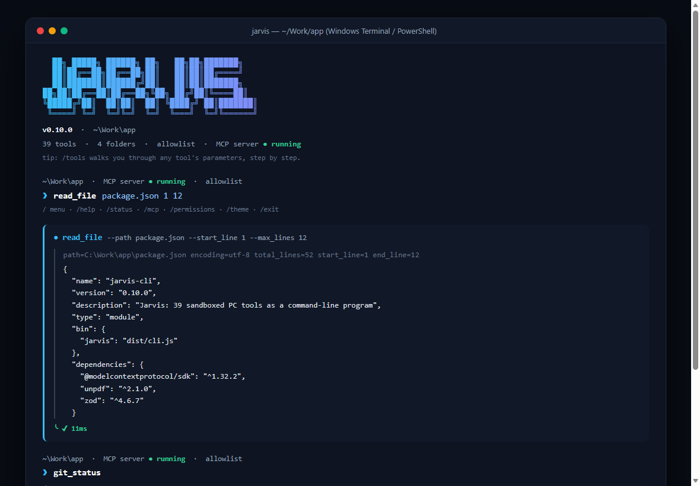
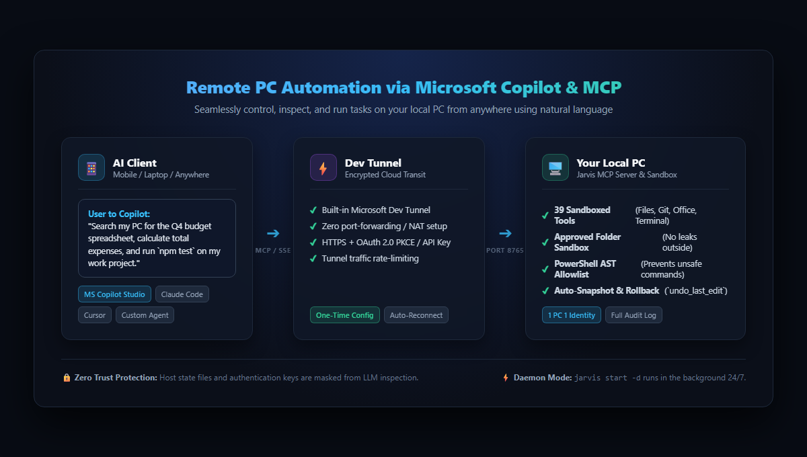
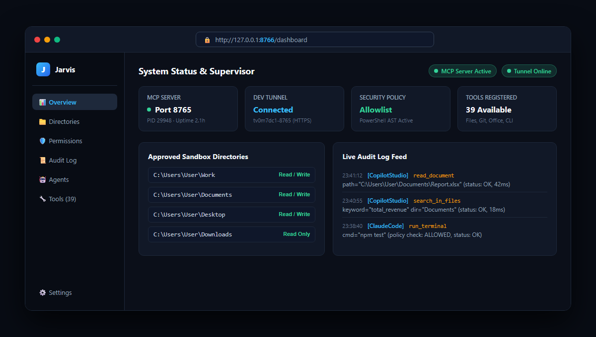

# Jarvis CLI

[](LICENSE)


**42 sandboxed PC tools (files, terminal, Git, web, wiki, VPN keep-alive, cloud CLIs) for your PC — accessible locally from your terminal or remotely through any AI client via MCP.**



```console
# Quick examples
$ jarvis list_files src
directory=C:\work\app\src  pattern=*  recursive=false  count=3
path        type  size_bytes  modified
cli.ts      file  8068        2026-11-06 10:35:17
core        dir   -           2026-11-06 10:26:01
tools       dir   -           2026-11-06 10:26:02

$ jarvis read_file notes.txt 1 20      # Positional arguments: path start_line max_lines
$ jarvis git_status                    # Structured Git status
$ jarvis                               # Interactive TUI mode (prompt, / menu, guided tool forms)
```

---

## Why Jarvis MCP Server?

> **"Control and automate your PC from anywhere via Microsoft Copilot on your phone, tablet, or laptop."**

Jarvis's single biggest advantage is that **by connecting it as an MCP (Model Context Protocol) server to AI clients like Microsoft Copilot (Copilot Studio), Claude, or Cursor, you can freely handle, inspect, and automate your local PC from anywhere in the world using natural language.**



### Key Highlights

- **Full Remote PC Automation (The Killer Feature)**:
  - **Zero router or firewall setup**: Powered by built-in **Microsoft Dev Tunnels**, Jarvis automatically exposes a secure HTTPS/OAuth endpoint without opening firewall ports, static IPs, or port-forwarding rules.
  - **Your personal AI assistant on the go**: Away from your desk or commuting? Simply ask Microsoft Copilot on your phone:
    - *"Find the latest Q4 financial report spreadsheet in my Documents folder and summarize top 3 takeaways."*
    - *"Run the integration test suite on my work PC, fix any broken imports, and show me the git diff."*
    - *"Start downloading the dataset in the background and notify me when it finishes."*
- **40 Production-Ready Local Tools**:
  - Beyond basic file operations, Jarvis includes PowerShell terminal execution, background process management, Office document text extraction (Word `.docx`, Excel `.xlsx`, PowerPoint `.pptx`, PDF), Git version control, AST code symbols extraction, long-term wiki memory, and enterprise cloud CLIs (`kubectl`, `az`, `pac`, `sas-viya`).
- **Ironclad Safety & Sandboxing**:
  - AI can never wander freely across your operating system.
  - **Approved Folders Sandbox**: Strict directory boundaries prevent access outside approved locations.
  - **PowerShell AST Allowlist Policy**: Every terminal command is statically inspected before execution; arbitrary or destructive commands are rejected.
  - **Automatic Pre-Modification Backups & 1-Click Rollback**: Before any file is modified or overwritten, a snapshot is saved. Run `undo_last_edit` to immediately revert unexpected changes.
  - **Tamper-Resistant Audit Logging**: Every single tool invocation is logged to `~/.jarvis/audit.log`. Jarvis's own configuration and secrets are masked from LLM inspection.
- **1 PC, 1 Identity (Zero-Drift Connectivity)**:
  - Your API key and Dev Tunnel ID are permanently tied to your OS user account (`~/.jarvis/identity.json`). Server restarts, CLI updates, or changing settings folders will **never break existing Copilot Studio or client connections**.
- **2-in-1 Flexibility**:
  - Use it locally as a standalone command-line tool with a rich, interactive TUI prompt (`jarvis`), or run it 24/7 as a background daemon (`jarvis start -d`) complete with a web management dashboard.



---

## Features

- **42 Sandboxed Tools** — File read/write/edit/search/share, PowerShell terminal execution, background job management, Git, code symbols, web search/fetch, Word/Excel/PowerPoint/PDF document extraction, wiki memory, task scheduler, GlobalProtect VPN status/keep-alive, kubectl, Azure CLI, Power Platform CLI.
- **Built-in Safety Guardrails** — Approved folder sandbox, terminal command allowlist, automatic edit backups (`undo_last_edit`), full audit logging (`audit.log`), secret file masking.
- **Clean, Script-Friendly Output** — Unadorned content for files, formatted tables for listings, separated stdout/stderr for commands, ANSI colors. Automatically outputs raw text when piped.
- **Interactive TUI Prompt** — Type `jarvis` to launch a full terminal UI featuring a `/` slash-command menu, step-by-step parameter forms (`/tools`), live autocomplete suggestions, and gradient themes.
- **Shell-Friendly** — Positional arguments, "Did you mean" typo suggestions, standard exit codes (`0` ok, `1` tool error, `2` missing args), PowerShell and Bash completions.
- **Dual Operating Modes** — In-process tool execution directly from terminal (zero server needed), or a local supervised MCP server (Dev Tunnel + web dashboard + OAuth 2.0).

---

## Installation

Requirements: **Node.js >= 22**, Git. (Optimized and verified for Windows using PowerShell. macOS/Linux requires `pwsh`).

### Method 1 — One-Line Global Install (Recommended)

```console
npm install -g https://github.com/Hannoah/jarvis-cli/archive/refs/heads/main.tar.gz && jarvis about
```

Upon installation, `jarvis about` prints the installed version and a quick introduction. Pre-compiled binaries (`dist/`) are bundled in the repository, so no compilation step is needed.

* To update: `jarvis update` (or re-run the install command).
* To uninstall: `npm uninstall -g jarvis-cli`.
* To install a specific version: replace `main.tar.gz` with a release tag, e.g. `refs/tags/v0.12.0.tar.gz`.

> Do not use `npm install -g github:Hannoah/jarvis-cli`. On npm 11, global installations from GitHub shorthand link to a temporary clone folder, breaking execution.

### Method 2 — From Source

```console
git clone https://github.com/Hannoah/jarvis-cli.git
cd jarvis-cli
npm install          # Install dependencies (dist/ is included)
npm link             # Register the `jarvis` global command
```

To run directly without linking: `node dist/cli.js <tool>`.

### Shell Completion (Optional)

```powershell
# PowerShell — add to your $PROFILE for persistence:
jarvis completion powershell | Out-String | Invoke-Expression
```

```bash
# Bash:
jarvis completion bash >> ~/.bashrc
```

---

## Usage

```console
jarvis <tool> [args]        Run a tool directly
jarvis list [filter]        List available tools (filter by name or description)
jarvis help <tool>          Show parameter schema and usage (= jarvis <tool> --help)
jarvis                      Interactive TUI mode (= jarvis shell)
jarvis completion <shell>   Generate shell completion script
jarvis cli [check|install]  Inspect or install external helper CLIs (git, az, kubectl, ...)
jarvis audit [options]      View recent audit logs
jarvis agents [options]     Inspect AI agents using the server/CLI
jarvis update               Check GitHub for newer releases and upgrade
```

### Passing Arguments

```console
jarvis read_file --path notes.txt --start_line 1 --max_lines 20   # Named flags
jarvis read_file notes.txt 1 20                                    # Positional (required first)
jarvis list_files src --recursive                                  # Boolean flags
jarvis wiki_append --json '{"slug":"todo","content":"- Buy milk"}' # JSON object
jarvis run_terminal "Get-Date -Format o"
```

- Values are automatically coerced according to the tool's JSON schema.
- Relative paths resolve against the **current working directory** (if inside an approved sandbox folder); otherwise, they resolve to the default workspace.

### Output and Exit Codes

| Context | Output Behavior |
|---|---|
| Terminal (TTY) | Formatted cards, tables, colors, indented JSON |
| Pipe / Redirect | Raw text output (`jarvis list_files . \| jq ...`) |
| `--raw` | Forces raw output in terminal |
| `NO_COLOR=1` | Disables ANSI color codes |

Exit codes: `0` Success · `1` Tool/execution error · `2` Missing required arguments.

### Automatic In-Place Update

When a newer release is published on GitHub, Jarvis asks whether you want to upgrade **on your very first command** in the terminal. Selecting `Update now` immediately installs the new version and **seamlessly re-runs your original command with the updated version**.

- Checks run at most once per hour and fail silently if offline.
- Non-interactive environments (pipes, scripts, AI agents, `--format json`, `--raw`, background server) are never prompted.
- To disable: set `JARVIS_NO_UPDATE_CHECK=1` in your environment or `~/.jarvis/.env`.

---

## Interactive TUI Mode

Run `jarvis` without arguments to launch the interactive prompt:

```text
  ██╗ █████╗ ██████╗ ██╗   ██╗██╗███████╗
  ██║██╔══██╗██╔══██╗██║   ██║██║██╔════╝
  ██║███████║██████╔╝██║   ██║██║███████╗
██╗██║██╔══██║██╔══██╗╚██╗ ██╔╝██║╚════██║
╚█████╔╝██║  ██║██║  ██║ ╚████╔╝ ██║███████║
 ╚════╝ ╚═╝  ╚═╝╚═╝  ╚═╝  ╚═══╝  ╚═╝╚══════╝
  v0.11.0  ·  ~\Work\app
  40 tools · 4 folders · allowlist · MCP server ● running
  tip: /tools walks you through any tool's parameters, step by step.

~\Work\app  ·  MCP server ● running  ·  allowlist
❯ read_file package.json 1 2
/ menu · /help · /status · /mcp · /permissions · /theme · /exit
● read_file  --path package.json --start_line 1 --max_lines 2
│ path=C:\Work\app\package.json  encoding=utf-8  total_lines=52  start_line=1  end_line=2
│ {
│   "name": "jarvis-cli",
╰ ✔ 11ms
```

### Slash Commands

| Command | Description |
|---|---|
| `/help` | General help and command overview |
| `/clear` | Clear screen (preserves Jarvis banner & status header; Ctrl+L also works) |
| `/status` | Versions, approved directories, security policy, MCP server state |
| `/doctor` | System diagnostic (Node, PowerShell, Git, devtunnel, kubectl, etc.) |
| `/tools` | Guided parameter input wizard for all 40 tools |
| `/dirs` | View, add, or remove approved sandbox directories |
| `/permissions`| Toggle Read, Write, and Terminal permissions or switch policy mode |
| `/allowlist` | View, add, remove, or check terminal allowlist commands |
| `/mcp` | View and copy MCP connection URL, API key, and client configs |
| `/start` `/stop` `/restart` | Supervise, shut down, or restart background MCP server |
| `/tunnel` | Dev Tunnel status and manual restart |
| `/theme [name]`| Switch accent theme (`blue`, `violet`, `emerald`, `amber`, `rose`, `mono`) |
| `/memory` | Inspect long-term wiki memory index |
| `/exit` | Exit the shell (`/quit`, Ctrl+D) |

- **`!command`**: Run quick shell commands through the sandboxed terminal engine (e.g., `!git status`).
- **Live Suggestions**: Typing `/` or any tool name displays live matching commands and parameters underneath.

---

## Running as an MCP Server

Run Jarvis as an MCP server to connect AI clients like Microsoft Copilot Studio, Claude, and Cursor.

### Controlling the Server

```console
jarvis start -d             # Start daemon in background: terminal remains free (--background)
jarvis start                # Start foreground supervisor (auto-recovers MCP server, tunnel, dashboard)
jarvis status               # View supervisor status, MCP server PID/uptime, and Dev Tunnel state
jarvis restart              # Restart the MCP server (applies newly saved settings)
jarvis stop                 # Gracefully shut down MCP server, Dev Tunnel, and dashboard
jarvis tunnel               # Inspect Dev Tunnel status and troubleshooting tips
jarvis tunnel restart       # Force reconnect Dev Tunnel
jarvis start --no-tunnel    # Run locally only without Dev Tunnel
jarvis open | jarvis url    # Open or print web dashboard URL (includes single-sign-on token)
jarvis install              # Register auto-start at login (Windows Task Scheduler / systemd)
jarvis uninstall            # Remove auto-start registration
```

### MCP Connection & AI Client Configuration

```console
jarvis mcp                   # View HTTPS tunnel URL, local URL, masked API key, and OAuth info
jarvis mcp key               # Print raw API key
jarvis mcp copy url|key      # Copy URL or key directly to clipboard
jarvis mcp config claude     # Print Claude Code registration command
jarvis mcp config cursor     # Print Cursor mcp.json snippet
jarvis mcp copy claude       # Copy Claude Code config to clipboard
jarvis mcp rotate --yes      # Issue a brand new API key (invalidates previous keys)
```

- **Authentication**: Supports `X-API-Key: <key>` or `Authorization: Bearer <key>` headers.
- **Microsoft Copilot Studio (OAuth 2.0)**:
  - Client ID: `jarvis`
  - Client Secret: Your Jarvis API key
  - Authorize URL: `https://<tunnel-url>/oauth/authorize`
  - Token URL: `https://<tunnel-url>/oauth/token`
- **Cursor (`~/.cursor/mcp.json`)**:
  ```json
  {
    "mcpServers": {
      "jarvis": {
        "url": "http://127.0.0.1:8765/mcp",
        "headers": {
          "X-API-Key": "<YOUR_API_KEY>"
        }
      }
    }
  }
  ```

---

## Access Control & Security Policies

All changes persist immediately to your settings file (`~/.jarvis/.env`). If the server is already running, execute `jarvis restart` to apply changes.

```console
jarvis dirs                          # List approved sandbox folders
jarvis dirs add <path>               # Approve directory (drive roots or missing paths are rejected)
jarvis dirs remove <path>            # Revoke folder approval (last folder cannot be removed)

jarvis permissions                   # Check Read / Write / Terminal state
jarvis permissions write off         # Toggle read | write | terminal to on | off
jarvis permissions mode blocklist --yes # Switch to blocklist mode (--yes required)

jarvis allowlist                     # List built-in and user-approved commands
jarvis allowlist add <cmd...>        # Add commands (general runners like powershell require --yes)
jarvis allowlist remove <cmd...>     # Remove user-added commands (built-ins cannot be removed)
jarvis allowlist check "git status"  # Dry-run policy check (does not execute or log)
```

---

## Helper CLI Verification & Installation

Jarvis integrates with external CLIs like `git`, `devtunnel`, `kubectl`, `az`, `pac`, and `sas-viya`. Jarvis can inspect what is installed and automatically install missing tools.

```console
jarvis cli                       # Inspect CLI status and binary paths (also: jarvis cli --json)
jarvis cli install kubectl az    # Install specific missing CLIs
jarvis cli install --yes         # Install all available missing CLIs automatically
```

- Uses `winget` on Windows and `brew` on macOS.
- Manual-only tools (like `sas-viya` or `pangpcli`) provide detailed download instructions instead of attempting unsupported package manager installs.

---

## Audit Logs & AI Agent Tracking

```console
jarvis audit                                  # View last 30 audit entries
jarvis audit --since 2h --status BLOCKED      # View blocked attempts in last 2 hours
jarvis audit --tool run_terminal --agent claude -n 100
jarvis agents                                 # View agents active in last 7 days
jarvis agents --since 1d --json
```

- **`jarvis audit`**: Streams `~/.jarvis/audit.log` (including rotated logs). Supports `--tool`, `--status`, `--agent`, `--since`, `--json`, and `--full`.
- **`jarvis agents`**: Aggregates clients connected to the MCP server by announced name (`initialize` clientInfo) or User-Agent, summarizing call counts, transit route (`tunnel` vs `local` vs `cli`), last active time, and favorite tools.

---

## AI Agents Using Jarvis CLI

When AI agents execute Jarvis as a subprocess:

```console
jarvis list --json                          # Tool list with full JSON schemas (inputSchema)
jarvis help read_file --format json         # Specific tool schema
jarvis read_file notes.txt --format json    # {"ok":true,"tool":"read_file","exit_code":0,"result":{...}}
jarvis run_terminal --json '{"command":"git status"}' --format json
```

- `--format json` guarantees a **single-line JSON output**. Exit codes: `0` ok, `1` tool error, `2` missing args.
- Identify your agent in the audit log by setting `JARVIS_AGENT=<name>` (Claude Code is detected automatically via `CLAUDECODE`).
- Spinners, ANSI colors, and interactive update prompts are automatically suppressed in non-interactive agent calls.

---

## Complete Tool Catalog (40 Tools)

| Category | Tools | Description |
|---|---|---|
| **Environment** | `get_pc_env`, `get_system_status` | PC resource metrics, allowed directories, security policy status |
| **Files** | `read_file`, `write_file`, `edit_file`, `list_files`, `search_in_files`, `share_file_url`, `read_document` | Full file operations, temporary mobile download links, & Office/PDF extraction |
| **Backup** | `undo_last_edit`, `list_file_backups`, `restore_file_backup` | Automatic snapshot backups & instant rollback |
| **Terminal** | `run_terminal`, `start_background_job`, `read_job_output`, `stop_job`, `list_background_jobs` | Sandboxed PowerShell execution & long-running jobs |
| **Git** | `git_status`, `git_diff`, `git_log`, `git_commit` | Structured repository inspection and commit management |
| **Code** | `list_code_symbols` | Extract functions, classes, and types without reading entire files |
| **Web** | `search_web`, `fetch_web_page` | Web search and public webpage text extraction |
| **Wiki Memory** | `wiki_index`, `wiki_search`, `wiki_read`, `wiki_append`, `wiki_create` | Persistent, long-term LLM knowledge memory |
| **System** | `open_in_default_app`, `manage_clipboard`, `send_notification` | Desktop notifications, clipboard management, default app launcher |
| **Scheduler** | `schedule_task`, `list_scheduled_tasks`, `delete_scheduled_task` | OS-level automated recurring task scheduler |
| **Enterprise** | `run_kubectl`, `run_azure_cli`, `run_pac_cli`, `run_viya_cli`, `deploy_viya_status_page` | Kubernetes, Azure, Power Platform, and SAS Viya operations |

---

## Configuration

Configuration is stored in `~/.jarvis/.env` (override with `JARVIS_HOME`):

```ini
# Semicolon-separated approved directories (~ and %USERPROFILE% supported)
PC_MCP_ALLOWED_DIRS=C:\Users\me\Work;C:\Users\me\Documents

# Server Ports (Default: MCP 8765, Dashboard 8766)
# PC_MCP_PORT=8765
# JARVIS_DASHBOARD_PORT=8766

# Permissions
PC_MCP_ENABLE_READ=true
PC_MCP_ENABLE_WRITE=true
PC_MCP_ENABLE_TERMINAL=true

# Terminal Policy: allowlist (recommended) | blocklist
PC_MCP_TERMINAL_MODE=allowlist
# Extra user-approved commands (semicolon-separated)
PC_MCP_EXTRA_ALLOWED_COMMANDS=Start-Process;Stop-Process

# Cloud CLI integrations (loaded into subprocess environment)
# KUBECONFIG=C:\Users\me\.kube\config
# JARVIS_DEFAULT_KUBECONFIG=C:\Users\me\clusters\demo-kubeconfig
# VIYA_CLI_DIR=C:\tools\sas-viya
# JARVIS_STATUS_DEPLOY_DIR=C:\Users\me\Work\status
```

---

## Development

```console
npm install
npm run dev -- list      # Run directly with tsx
npm run build            # Compile TypeScript (src/ -> dist/)
npm test                 # Run test suite (41 tests)
npm run typecheck        # Strict TypeScript type check
```

- Repository structure:
  - `src/cli.ts` — CLI entry point & dispatch
  - `src/supervisor/`, `src/server/http.ts`, `src/main.ts` — MCP server daemon, Dev Tunnel, web dashboard
  - `src/tui.ts` — Interactive terminal prompt and menus
  - `src/cliutil.ts` — CLI argument parsing, tokenizing, table/card rendering
  - `src/tools/` — 40 tool implementations
  - `src/{core,files,security,system}` — Configuration, sandbox validation, policies, backups
  - `LLMWiki/` — Persistent architectural decisions, work history, and release runbook

---

## License

[MIT](LICENSE) © 2026 Hannoah
